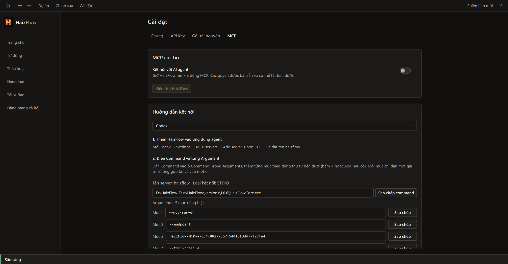

# Kết nối HaizFlow với AI agent

[Trang chính](../README.vi.md) · [Sử dụng](user-guide.vi.md) · [English](mcp.md)

MCP cho phép agent tương thích làm việc với dự án, phụ đề, xử lý video, tải xuống và đăng bài trong HaizFlow. Giữ HaizFlow mở trong lúc dùng kết nối.

## Kết nối trong bốn bước

1. Mở **Cài đặt → MCP**, bật kết nối và xem lại các quyền.
2. Trong **Hướng dẫn kết nối**, chọn agent: Codex, Claude Code, Claude Desktop, Antigravity hoặc ứng dụng tương thích khác.
3. Làm theo hướng dẫn đang hiển thị. Sao chép **Command** và từng **Argument** vào các ô riêng, hoặc dùng yêu cầu thiết lập/cấu hình mà app tạo cho agent đó. Giữ nguyên các máy chủ khác đã có.
4. Lưu và kết nối lại máy chủ trong agent. Bấm **Sao chép câu lệnh thử** trong HaizFlow, rồi gửi sang agent để kiểm tra.

Dùng thông tin được tạo trên máy của bạn, không chép đường dẫn trong ảnh minh họa. Nếu agent hỏi loại kết nối, chọn **STDIO**, không nhập địa chỉ web.

| Agent | Dùng phần nào trong hướng dẫn HaizFlow? |
| --- | --- |
| Codex | Command và từng Argument riêng biệt. |
| Claude Code | Yêu cầu thiết lập được tạo sẵn; duyệt thay đổi nếu agent hỏi. |
| Claude Desktop | Cấu hình có sẵn và hướng dẫn mở cài đặt MCP cục bộ. |
| Antigravity IDE/App | Chọn đúng phiên bản bạn dùng rồi sao chép cấu hình. |
| Agent tương thích khác | Máy chủ stdio cục bộ với đúng Command và từng Argument. |

Cấu hình có thể trỏ tới tệp Core theo phiên bản. Sau khi cập nhật hoặc chuyển vị trí HaizFlow, sao chép lại thông tin hiện tại nếu lệnh cũ không còn chạy. Không đổi Command thành lệnh mở giao diện thông thường hoặc thêm shortcut tự khởi động.

## Quyền thao tác

Bật MCP sẽ cấp quyền điều khiển, dùng dịch vụ trực tuyến, xóa và đăng bài cho lần mở app hiện tại. Tắt từng quyền bạn không muốn cấp. Nếu tắt quyền điều khiển, agent chỉ còn xem thông tin. Thoát HaizFlow sẽ đặt lại MCP và các quyền.

Khi đã có quyền phù hợp, các yêu cầu xử lý, xóa hoặc đăng bài không cần xác nhận thêm trong trang MCP của HaizFlow. Agent vẫn có thể hỏi theo chính sách riêng. Hãy chỉ rõ dự án, video và tài khoản cần dùng; dịch vụ trực tuyến có thể tính phí.

## Kiểm tra kết nối

**Kiểm tra HaizFlow** kiểm tra phía app. Kết quả thành công chưa có nghĩa agent đã được cài đúng; cần gửi câu lệnh thử ngay trong agent nữa.

Nếu chưa kết nối được:

- Kiểm tra HaizFlow đang mở và MCP đã bật.
- Sao chép lại thông tin hiện tại, mỗi Argument vào một ô riêng.
- Lưu và kết nối lại máy chủ trong agent.
- Bấm **Kiểm tra HaizFlow**, rồi thử lại từ agent.

## Dùng gọn, tiết kiệm lượt trao đổi

Yêu cầu đúng dự án và phần cần làm, thay vì đọc toàn bộ dữ liệu. Ví dụ: “Mở dự án X, xem ba câu phụ đề này và đề xuất sửa xưng hô.” Xem đề xuất trước khi yêu cầu áp dụng hoặc đăng bài.

Cấu hình MCP gọn mặc định giúp giảm thông tin lặp lại, không bảo đảm tiết kiệm một mức quota cố định. Các lệnh và ví dụ chuyên sâu nằm trong phần mở rộng của [tài liệu tiếng Anh](mcp.md).
