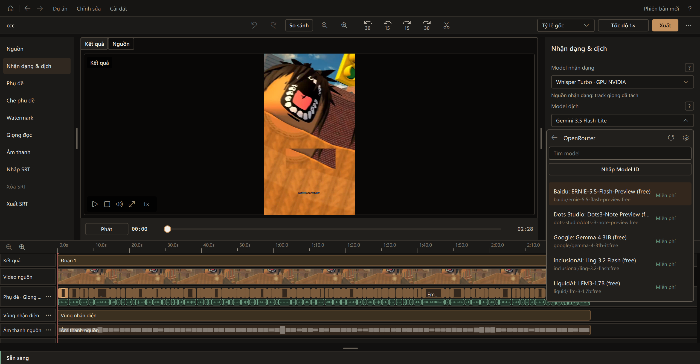

# Kết nối API dịch

[Trang chính](../README.vi.md) · [Sử dụng](user-guide.vi.md) · [English](translation-api.md)

HaizFlow hỗ trợ Gemini, OpenAI, DeepSeek, OpenRouter và API tương thích tùy chỉnh để **dịch**. Giọng đọc được chọn riêng; Zernio dành cho đăng mạng xã hội.

## 1. Thêm và chọn API sử dụng

1. Mở **Cài đặt → API Key**, chọn nhà cung cấp.
2. Thêm tên và key. Với API tùy chỉnh, nhập thêm Base URL.
3. Bấm **Kiểm tra kết nối** cạnh key vừa thêm.
4. Bấm **Sử dụng** ở key muốn dùng.

Mỗi nhà cung cấp có một key đang sử dụng. Khi có nhiều key, chọn tại Cài đặt, không chọn lại trong từng dự án. Thay key áp dụng cho các lượt xử lý tiếp theo của nhà cung cấp đó, không đổi lượt đã bắt đầu.

Key được lưu trong Windows Credential Manager. Không chia sẻ key trong ảnh hoặc yêu cầu hỗ trợ.

## 2. Chọn model trong dự án

Trong Thủ công, Tự động hoặc Cài đặt hàng loạt, mở **Model dịch**, chọn nhà cung cấp rồi chọn model.

Model được chọn theo dự án, không nằm trong trang API Key. Nếu chưa chọn key, quay lại Cài đặt để thêm hoặc chọn API sử dụng.

OpenRouter có ô tìm kiếm và nút tải lại. Danh sách gần nhất mở ngay; bấm tải lại khi cần cập nhật. Nhãn **Miễn phí**, **Tính phí**, **Chưa rõ phí** dựa trên thông tin gần nhất, không phải hạn mức còn lại của bạn. Model miễn phí vẫn có thể quá tải, bị hạn chế hoặc tạm ngừng. App không tự đổi sang model tính phí.

Dùng **Nhập Model ID** khi model tương thích chưa có trong danh sách. ID phải đúng như nhà cung cấp công bố; nhập được ID không có nghĩa máy chủ chắc chắn hỗ trợ.

## 3. Chọn văn phong và suy luận

Mở **Văn phong & hướng dẫn** để chọn cách dịch và thêm bối cảnh, tên nhân vật, xưng hô. **Tự nhiên** thường phù hợp hội thoại; **Sát nghĩa** phù hợp khi cần bám gần câu gốc hơn.

Mục **Mức** hoặc **Suy luận** chỉ xuất hiện khi model hỗ trợ. Văn phong và suy luận độc lập: đổi văn phong không tự tăng suy luận. Mức cao có thể tốn thêm thời gian và token, không bảo đảm bản dịch luôn tốt hơn. Model bắt buộc suy luận không có lựa chọn tắt.

## API tùy chỉnh và Ollama

API tùy chỉnh dùng dịch vụ tương thích OpenAI Chat Completions, kể cả máy chủ Ollama cục bộ tương thích.

- Ví dụ dịch vụ bên ngoài: `https://api.example.com/v1`.
- Ví dụ Ollama trên máy: `http://localhost:11434/v1`.
- Chỉ nhập Base URL, không thêm `/chat/completions` hoặc `/responses`.
- Nhập key của máy chủ. Nếu Ollama cục bộ không kiểm tra key, ô key bắt buộc có thể điền giá trị như `ollama`.
- Chọn model đã có trên máy chủ đó. HaizFlow không tự tải model Ollama.

Hộp nhập model trong dự án có các cách xuất JSON. Chọn cách mà máy chủ/model hỗ trợ. Máy chủ truy cập được không cần xác thực chỉ được báo là kết nối được, không coi đó là bằng chứng key hợp lệ.

## Kiểm tra kết nối cho biết điều gì?

Mỗi lần kiểm tra đều liên hệ lại dịch vụ, không chỉ dùng trạng thái xanh cũ hay danh sách model công khai. Thao tác này không chạy câu dịch mẫu hoặc dùng token tạo nội dung.

Kết quả thành công xác nhận quyền truy cập vừa kiểm tra, không bảo đảm mọi model đều dùng được, tài khoản còn tiền hay lượt dịch dài sẽ thành công. Một số API tùy chỉnh không hỗ trợ cách kiểm tra này nhưng vẫn có thể dịch. Tải lại danh sách model cũng khác với kiểm tra key.

## Chi phí, dữ liệu và lỗi

- Giá, hạn mức và chính sách dữ liệu do dịch vụ quy định. Nhãn miễn phí/tính phí chỉ để tham khảo, không bảo đảm chi phí thực tế.
- Khi dịch, phụ đề và hướng dẫn được gửi tới dịch vụ đã chọn. Đọc cảnh báo thu thập dữ liệu OpenRouter khi có; quyền đồng ý chỉ dành cho kết nối và model đó.
- App dùng ngân sách đầu ra mặc định của nhà cung cấp, không đặt một trần token chung tự ước lượng. Giới hạn của dịch vụ vẫn áp dụng; suy luận có thể tăng lượng dùng và thời gian chờ.
- Phụ đề được dịch theo nhóm. Các nhóm hoàn tất được lưu để tiếp tục khi còn hợp lệ.
- Báo giới hạn lượt gọi không nhất thiết nghĩa là bạn đã hết hạn mức ngày; còn có thể do quá tải, quyền tài khoản hoặc hạn chế của nhà cung cấp.
- Kết quả thiếu hoặc không thể ghép đúng vào phụ đề không được coi là bản dịch hoàn tất. Xem thông báo và bấm **Chi tiết** khi cần log kỹ thuật.
- Tạm dừng sẽ ngắt chờ yêu cầu ở phía app, nhưng không bảo đảm nhà cung cấp dừng tính toán hay miễn phí lượt đã nhận.

Nếu muốn dịch trên máy không cần API key, chọn HY-MT2.

## Xem thêm

[Văn phong và hướng dẫn](gemini-translation-guidance.md) · [Kết nối MCP](mcp.vi.md) · [Trợ giúp](support.vi.md)
