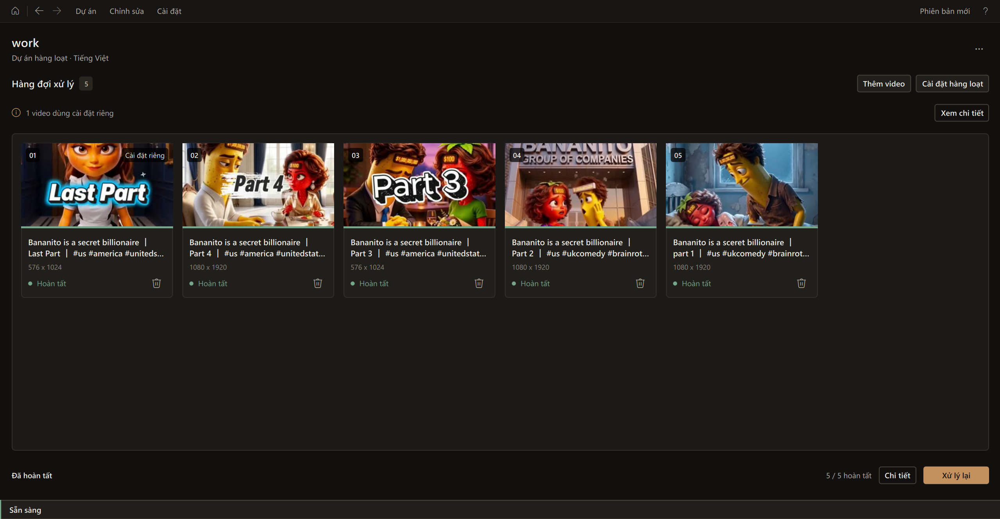

# Use HaizFlow

[Home](../README.md) · [Installation](install.md) · [Tiếng Việt](user-guide.vi.md)

## Your first video

1. Choose **New project → Manual**, name it and import a local video.
2. Open **Recognition & translation**, choose recognition and translation models and a target language, then run.
3. Review the captions, wording and names before generating voice.
4. If needed, use the picture tool to detect and cover original captions and the voice tool to generate speech.
5. Preview the result, check timing and levels, then choose **Export** and a destination.

You do not need to run every tool. Caption-only or audio-only edits can also be exported.

## Choose a project type

- **Manual:** work on each tool independently and review detailed edits.
- **Automatic:** choose language, models, voice, picture and audio settings before processing a video.
- **Batch:** queue multiple videos with common settings and track each result separately.
- **Downloads:** import videos, channels or audio from supported public links.
- **Social publishing:** prepare posts and publish through your Zernio account.

Back/Forward navigate pages. Undo/Redo in the editor apply to supported edits, not page history.

## Download from Douyin

Install **Douyin browser (Chromium)** in **Settings → Resource Packs**, then choose **Create Douyin session** on the Downloads page. Complete any verification yourself in the window that opens. The browser closes when the session is ready; Video, Channel and Audio share that session.

No login or personal browser profile is required. If the pack is missing, HaizFlow shows a notification and does not download it automatically. Use **Refresh session** when a new session is needed.

## Recognition and translation

Choose recognition and translation models and the target language in the recognition tool.

Whisper recognizes speech. Translate locally with HY-MT2 or choose Gemini, OpenAI, DeepSeek, OpenRouter or a compatible custom API. Select the key to use in **Settings → API Key**; choose the provider and model inside each project. See [API setup](translation-api.md).

The app's target languages include Vietnamese, English, Chinese, Japanese, Korean and Spanish. Choose a voice model that supports the target language too.

Use **Style & guidance** for tone, context and names/address conventions. Supported **Level/Reasoning** options are separate: changing style does not raise reasoning. Free-model labels do not guarantee available quota or server capacity.

After vocal separation, check the recognition-source label to see whether it uses the separated voice track or source audio. Review noisy recordings, loud background music and overlapping speech carefully.

## Edit captions

Select a caption on the timeline to adjust text, timing and style. The text-editing dialog lets you navigate between segments. **Save** is enabled only after a change; **Discard changes** restores the saved text.

Adjust size, color, outline, shadow and caption area. Drag the caption area in the preview to change its layout. Karaoke highlighting follows each word's timing.

Open the font picker to preview the bundled fonts. Bangers remains the Latin default; Chinese, Japanese and Korean use suitable regional fonts or fallbacks when needed. No additional font installation is required.

Import or export source/translated SRT from the editor. Review text and timing after importing, especially when mixing languages. Importing an SRT does not translate its contents automatically.

Review translations and names. If you change wording after generating voice, regenerate the affected segments so speech and captions agree.

## Picture and original captions

In the picture tool, choose whether to preserve the original video or cover its captions. For coverage, choose blur or background patching, review the detected area and apply it.

OCR detects text regions for original-caption coverage. Preview several points and adjust the coverage area to suit the video. The preview updates after processing for review before export.

Click the original-caption region in the preview to reveal its editing box. Drag the box to move it or drag an edge/corner to resize it, then choose **Apply**. Dragging alone does not change the saved result. **Restore detected region** restores and immediately applies the original OCR result.

Watermarks may be text, images or video. **Move** is enabled by default; turn it off for a fixed position. Drag and preview placement, size and opacity before export. Dragging caption placement manually turns off automatic alignment to the cover box so the app does not snap it back. Only use assets you have permission to use.

## Voice

Select a voice before choosing **Generate voice**. Listen to samples before processing the whole video.

In Manual, choose **All**, **This sentence** or selected sentences on the timeline. **This sentence** follows the current timeline selection/playhead; check the highlighted sentence before running. Only the chosen sentences are regenerated; other valid voice clips are kept.

VieNeu is for Vietnamese. If the text still contains unsupported characters, such as Chinese characters left in an imported SRT, correct those captions or choose another compatible voice model. Changing the language label alone does not change the text.

- **Built-in voice:** use one voice for the selected speech.
- **Multiple speakers:** group speakers from the source recording and assign consistent voices. This does not automatically clone their original voices.
- **Reference/voice cloning:** use a selected sample you have permission to use. Clear speech from one person with little background music is generally easier to process.

Speaker identification is bundled with the app and runs on CPU. Listen through the dialogue and adjust each group's voice to suit the character. For reference samples, choose clear speech from one person.

The current OmniVoice checkpoint is **noncommercial**. Do not assume it can be used for ads, monetized videos or client work. You also need appropriate permission for any reference voice.

## Batch processing

1. Create a **Batch** project and add your videos.
2. Open **Batch settings**, set translation, voice, captions and watermark, then apply.
3. Check the **Individual settings** badges. Review those videos before replacing their choices with common settings.
4. Choose **Process/Rerun** and select all videos or just the ones you need. To keep successful results, select only unfinished or failed videos.
5. Follow each card and the compact bottom row. Use **Details** for export results; remove unwanted videos with their card's delete button when idle.

You can queue another supported project while one is processing. Queued does not mean all heavy tasks run at once.

## Audio and background music

Vocal separation uses Demucs according to the app's CPU/GPU mode. Install its matching pack before running it.

Check the source, voice and music tracks on the timeline. Adjust levels and mute tracks as needed to avoid hearing both original and replacement speech.

Import music from a file or supported link. Enable music looping to cover the video, and automatic ducking to lower music under speech. These options are also available in Automatic settings.

## Pause, continue and rerun

**Pause** stops at a point where completed work can be saved. Valid completed results are retained so **Continue** does not need to start everything over.

**Continue** uses the paused run's settings. Choose **Rerun** when you want to process with new settings. Review the confirmation before replacing a tool's current result.

Video-processing status appears in the app status strip. Resource download/install progress stays on the Resource packs page rather than sharing the video strip.

## Preview and export

Seek using the timeline or preview controls. Use **Compare** to view the source alongside your edited result. **Undo/Redo** lets you review edits in the editor.

Review the first caption, speaker changes, music sections and the end of the video. Check fonts, caption placement, watermark and audio levels.

Choose **Export**, quality and destination. Existing files require overwrite confirmation. Save exports outside HaizFlow's managed project folders to keep an independent copy. Export does not automatically run additional AI tools you did not select.

## Social publishing

Add and check Zernio keys in **Settings → API Key**, then choose **Use** for the key you want. A successful check is not a guarantee that a later upload will satisfy platform limits.

Create a publishing project, choose the account and post content, add local videos or renders from projects, and verify the destination before confirming. Use **Open post** after successful publication to check it.

Platforms and Zernio have their own limits, charges and rules. Ensure you have content rights before publishing.

## Connect an AI agent

Use **Settings → MCP** to connect a compatible agent and keep HaizFlow open. Review permissions before asking it to process, delete or publish. See the [illustrated MCP guide](mcp.md).

## Errors and technical logs

Error notifications show a short explanation. **Details** opens the technical log; **Confirm** or the close button dismisses the notification. Project menus also provide technical logs. Do not share keys, cookies or private media when reporting an issue.

## Related guides

See [Installation](install.md) for resources, API keys, storage and updates. [Help](support.md) covers resource management and contacting support. Keep API keys and private data out of support requests.
