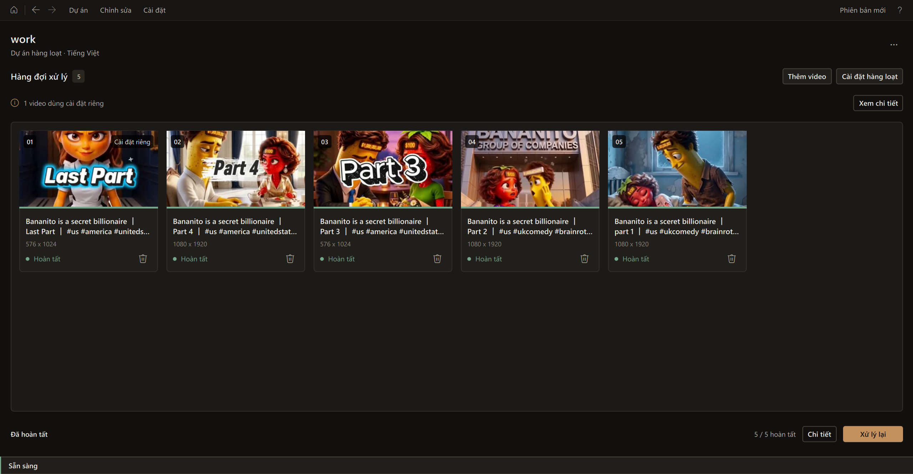

# Sử dụng HaizFlow

[Trang chính](../README.vi.md) · [Cài đặt](install.vi.md) · [English](user-guide.md)

## Video đầu tiên

1. Chọn **Dự án mới → Thủ công**, đặt tên và nhập video từ tệp.
2. Trong công cụ **Nhận dạng & dịch**, chọn model nhận dạng, model dịch và ngôn ngữ đích, rồi chạy.
3. Xem lại nội dung phụ đề, chỉnh câu chữ và tên riêng trước khi tạo giọng.
4. Nếu cần, dùng **Hình ảnh** để tìm và che phụ đề gốc; dùng **Giọng đọc** để tạo giọng.
5. Phát xem trước, kiểm tra âm lượng và thời gian. Chọn **Xuất**, chọn nơi lưu và xác nhận.

Bạn không phải chạy đủ các công cụ. Chỉ chỉnh phụ đề hoặc nhạc nền cũng có thể xuất video.

## Chọn cách làm việc

- **Thủ công:** chỉnh từng công cụ độc lập; phù hợp khi bạn cần kiểm tra và sửa chi tiết.
- **Tự động:** đặt ngôn ngữ, model, giọng, hình ảnh và âm thanh trước khi chạy một video.
- **Hàng loạt:** thêm nhiều video vào hàng đợi và dùng thiết lập chung. Theo dõi tiến trình và kết quả của từng video.
- **Tải xuống:** nhập video, kênh hoặc âm thanh từ liên kết công khai được hỗ trợ.
- **Đăng mạng xã hội:** chuẩn bị bài đăng và gửi qua tài khoản Zernio của bạn.

Dùng Quay lại/Tiến tới để chuyển trang. Hoàn tác/Làm lại trong trình sửa dành cho các thay đổi chỉnh sửa, không phải lịch sử trang.

## Tải từ Douyin

Cài **Trình duyệt Douyin (Chromium)** tại **Cài đặt → Gói tài nguyên**, rồi bấm **Tạo phiên Douyin** trong trang Tải xuống. Nếu Douyin yêu cầu xác minh, hãy thao tác trong cửa sổ vừa mở. Trình duyệt tự đóng khi phiên đã sẵn sàng; phiên dùng chung cho Video, Kênh và Âm thanh.

Bạn không cần đăng nhập hoặc dùng dữ liệu trình duyệt cá nhân. Khi chưa cài gói, app thông báo và không tự tải. Chỉ bấm **Làm mới phiên** khi cần tạo lại phiên.

## Nhận dạng và dịch

Chọn model nhận dạng, model dịch và ngôn ngữ đích trong **Nhận dạng & dịch**.

Whisper nhận dạng lời nói. Bạn có thể dịch trên máy với HY-MT2 hoặc chọn Gemini, OpenAI, DeepSeek, OpenRouter, API tương thích tùy chỉnh. Chọn key sử dụng tại **Cài đặt → API Key**; chọn nhà cung cấp và model trong từng dự án. Xem [hướng dẫn API](translation-api.vi.md).

Các ngôn ngữ đích gồm tiếng Việt, Anh, Trung, Nhật, Hàn và Tây Ban Nha. Chọn thêm model giọng đọc phù hợp với ngôn ngữ đích.

Mở **Văn phong & hướng dẫn** để đặt cách dịch, bối cảnh, tên nhân vật và xưng hô. **Mức/Suy luận** được chọn riêng khi model hỗ trợ; đổi văn phong không tự tăng suy luận. Nhãn model miễn phí không bảo đảm còn hạn mức hoặc máy chủ luôn sẵn sàng.

Nếu đã tách giọng, xem dòng nguồn nhận dạng để biết công cụ đang dùng track giọng hay âm thanh nguồn. Video có tiếng ồn, tiếng nhạc lớn hoặc lời nói chồng nhau cần được kiểm tra kỹ hơn.

## Chỉnh phụ đề

Chọn đoạn trên timeline để sửa nội dung, thời gian và kiểu chữ. Mở cửa sổ chỉnh nội dung để xem các đoạn trước/sau. **Lưu** chỉ khả dụng khi có thay đổi; **Bỏ thay đổi** trả lại nội dung đã lưu.

Bạn có thể đổi kích thước, màu, viền, bóng và vùng hiển thị. Kéo vùng phụ đề trong preview để điều chỉnh bố cục. Phụ đề karaoke tô theo thời gian từng từ.

Mở danh sách font để xem mẫu trước khi chọn. Bangers là mặc định cho chữ Latin; tiếng Trung, Nhật, Hàn có font phù hợp và font dự phòng khi cần. Bạn không phải cài thêm font.

Nhập hoặc xuất SRT gốc/bản dịch từ trình sửa. Sau khi nhập, kiểm tra lại nội dung và thời gian, nhất là tệp lẫn nhiều ngôn ngữ. Nhập SRT không tự dịch nội dung trong tệp.

Xem lại bản dịch và tên riêng. Khi đổi nội dung sau khi đã tạo giọng, tạo lại những đoạn cần thiết để lời và phụ đề khớp nhau.

Sửa phụ đề không tự tạo lại giọng. Dùng phạm vi tạo giọng để cập nhật đúng các câu đã sửa.

## Hình ảnh và phụ đề gốc

Trong **Hình ảnh**, chọn giữ video gốc hoặc che phụ đề gốc. Nếu che, chọn **Làm mờ** hoặc **Vá nền**, kiểm tra vùng phụ đề rồi áp dụng.

OCR tìm vùng chữ để che phụ đề gốc. Xem trước ở vài thời điểm và điều chỉnh vùng che theo video. Preview cập nhật sau khi xử lý để bạn xem kết quả trước khi xuất.

Bấm trực tiếp vào vùng phụ đề gốc trên preview để hiện khung chỉnh. Kéo khung để đổi vị trí, kéo cạnh/góc để đổi kích thước, rồi bấm **Áp dụng**. Việc kéo chưa thay đổi kết quả đã lưu. **Khôi phục vùng nhận diện** trả về vùng OCR đã quét và áp dụng ngay.

Watermark có thể là chữ, ảnh hoặc video. **Di chuyển** được bật mặc định; bỏ tick để giữ vị trí cố định. Kéo và xem trước vị trí, kích thước, độ trong suốt. Khi kéo phụ đề bằng tay, app bỏ tự căn vào vùng che để không đưa chữ về vị trí cũ. Chỉ thêm tài sản bạn có quyền sử dụng.

## Giọng đọc

Chọn giọng trước khi bấm **Tạo giọng**. Có thể nghe mẫu trước khi chạy cả video.

Trong Thủ công, chọn phạm vi **Toàn bộ**, **Câu này** hoặc chọn một số câu trên timeline. **Câu này** theo câu đang chọn/vị trí đang xem; kiểm tra câu được đánh dấu trước khi chạy. Chỉ các câu trong phạm vi đó được tạo lại, những đoạn giọng còn hợp lệ khác được giữ nguyên.

VieNeu dành cho tiếng Việt. Nếu câu còn ký tự không được hỗ trợ, chẳng hạn chữ Hán sót trong SRT nhập vào, hãy sửa phụ đề hoặc chọn model giọng khác phù hợp. Chỉ đổi nhãn ngôn ngữ không làm thay đổi nội dung câu.

- **Giọng dựng sẵn:** dùng cùng một giọng cho các câu đã chọn.
- **Nhận diện nhiều người nói:** phân nhóm người nói từ âm thanh nguồn và gán giọng đọc nhất quán. Không tự nhân bản giọng nguồn.
- **Mẫu giọng/nhân bản giọng:** dùng mẫu bạn lựa chọn và có quyền sử dụng; mẫu rõ lời, ít nhạc và một người nói thường dễ xử lý hơn.

Nhận diện người nói chạy trên CPU và được tích hợp trong ứng dụng. Nghe lại hội thoại và điều chỉnh giọng của từng nhóm theo nhân vật trong video. Với mẫu giọng, ưu tiên đoạn chỉ có một người nói rõ lời.

Checkpoint OmniVoice hiện tại **giới hạn phi thương mại**. Không mặc định dùng cho quảng cáo, video kiếm tiền hoặc khách hàng. Quyền của người có giọng trong mẫu cũng phải được bảo đảm.

## Xử lý hàng loạt

1. Tạo dự án **Hàng loạt** và thêm video.
2. Mở **Cài đặt hàng loạt**, chọn dịch, giọng, phụ đề, watermark rồi áp dụng.
3. Kiểm tra nhãn **Cài đặt riêng**. Xem lại những video đó trước khi thay bằng cài đặt chung.
4. Bấm **Xử lý/Xử lý lại**, chọn toàn bộ hoặc các video cần chạy. Muốn giữ kết quả đã thành công, chỉ chọn các video chưa xong hoặc bị lỗi.
5. Theo dõi từng thẻ và hàng trạng thái dưới cùng. Bấm **Chi tiết** để xem kết quả xuất; dùng nút xóa trên thẻ để bỏ video không cần khi đang rảnh.

Bạn có thể đưa dự án khác được hỗ trợ vào hàng đợi khi một dự án đang xử lý. Vào hàng đợi không có nghĩa các bước nặng chạy đồng thời.

## Âm thanh và nhạc nền

**Tách giọng** dùng Demucs theo chế độ CPU/GPU của ứng dụng. Cài gói tương ứng trước khi chạy.

Trong timeline, kiểm tra track âm thanh nguồn, giọng đọc và nhạc nền. Chỉnh âm lượng và tắt tiếng theo nhu cầu để tránh nghe đồng thời lời gốc và lời mới.

Nhập nhạc từ tệp hoặc liên kết được hỗ trợ. Bật **Lặp nhạc nền** nếu muốn nhạc phủ video, và **Tự giảm nhạc khi có lời** để lời dễ nghe hơn. Các lựa chọn này cũng có trong thiết lập Tự động.

## Tạm dừng, tiếp tục và chạy lại

**Tạm dừng** dừng công việc tại điểm có thể lưu. Những phần hoàn tất, còn hợp lệ được giữ để **Tiếp tục** không phải làm lại từ đầu.

**Tiếp tục** dùng thiết lập của lượt đang tạm dừng. Khi muốn đổi thiết lập, chọn **Chạy lại** để bắt đầu một lượt mới. Kiểm tra thông báo xác nhận trước khi thay kết quả hiện tại.

Tiến trình video hiển thị trên thanh trạng thái của ứng dụng. Tiến trình tải/cài gói hiển thị trong Gói tài nguyên, không dùng chung thanh trạng thái video.

## Xem trước và xuất

Dùng timeline hoặc thanh dưới preview để tua. Chọn **So sánh** để đối chiếu video gốc và kết quả chỉnh sửa. **Hoàn tác/Làm lại** giúp xem lại các thay đổi trong trình sửa.

Dùng nút kính lúp hoặc con lăn chuột để phóng to/thu nhỏ. Khi phóng to, kéo chuột trái trên nền để dịch chuyển hình; kéo trên khung OCR, phụ đề hoặc watermark để chỉnh đối tượng. Mỗi dự án nhớ bước chỉnh gần nhất khi mở lại.

Nghe và xem ít nhất vài đoạn: câu đầu, lúc chuyển người nói, chỗ có nhạc và cuối video. Kiểm tra font, vùng phụ đề, watermark và âm lượng.

Chọn **Xuất**, chọn chất lượng và nơi lưu. Nếu tệp đã có, ứng dụng yêu cầu xác nhận ghi đè. Lưu bản xuất ngoài các thư mục dữ liệu dự án do HaizFlow quản lý để giữ bản sao độc lập. Xuất không tự chạy thêm các công cụ AI bạn chưa chọn.

## Đăng mạng xã hội

Thêm và kiểm tra Zernio key trong **Cài đặt → API Key**, rồi chọn **Sử dụng** ở key muốn dùng. Kiểm tra thành công không bảo đảm lượt đăng sau luôn đáp ứng mọi giới hạn của nền tảng.

Tạo dự án đăng bài, chọn tài khoản và nội dung, thêm video cục bộ hoặc video đã xử lý từ dự án, rồi kiểm tra nơi đăng trước khi xác nhận. Sau khi đăng, dùng **Mở bài đăng** để xem trên nền tảng.

Nền tảng và dịch vụ Zernio có hạn mức, chi phí và quy định riêng. Hãy bảo đảm quyền sử dụng nội dung trước khi đăng.

## Kết nối AI agent

Mở **Cài đặt → MCP** để kết nối agent tương thích và giữ HaizFlow mở. Xem lại quyền trước khi yêu cầu xử lý, xóa hoặc đăng bài. Xem [hướng dẫn MCP có ảnh](mcp.vi.md).

## Thông báo lỗi và log kỹ thuật

Thông báo lỗi tóm tắt nguyên nhân. **Chi tiết** mở log kỹ thuật; **Xác nhận** hoặc nút đóng sẽ bỏ thông báo. Bạn cũng có thể mở log từ menu dự án. Không gửi key, cookie hoặc media riêng tư khi báo lỗi.

## Tài liệu liên quan

Xem [hướng dẫn cài đặt](install.vi.md) để chọn gói, API key, vị trí lưu dữ liệu và cập nhật. Trang [Trợ giúp](support.vi.md) hướng dẫn quản lý tài nguyên và liên hệ hỗ trợ. Không gửi API key hoặc dữ liệu riêng tư khi liên hệ.
